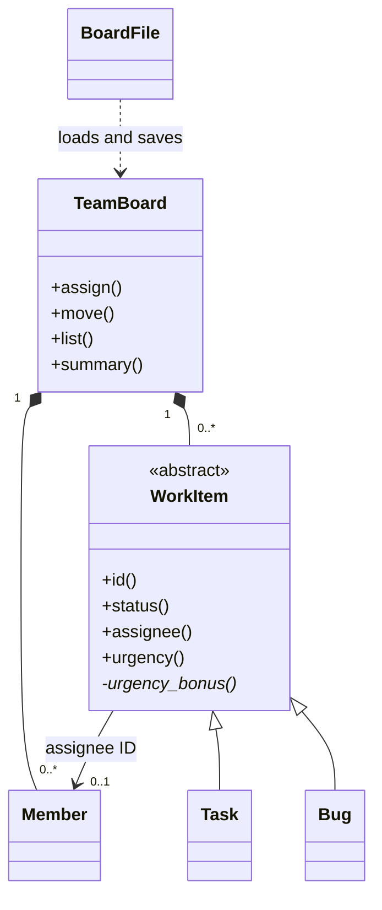

# System design

## Problem and scope

A small team needs one list that shows what to do, who owns each item, and which deadlines have passed. The application keeps one board per file. A team member is an assignee identified by a numeric ID. Duplicate display names are allowed. The program is intended for a local, shared workstation or a single operator coordinating a team. Remote synchronization, logins, permissions, and audit history are outside this model.

GitHub Issues pairs issues with a repository and supports assignees and issue management. Trello represents work as cards within lists on a board. Those products inform the choice to present one queue of work, model ownership separately from workflow state, and let users filter the queue. A command-line board with a local snapshot minimizes setup and makes the state rules easy to exercise with repeatable commands. [GitHub Issues documentation](https://docs.github.com/en/issues/tracking-your-work-with-issues/learning-about-issues/about-issues) · [Trello board basics](https://trello.com/en/guide/trello-101)

## Mathematical model

Let M be the set of members and W the set of work items. Each member and item has a unique positive integer ID within its own set. An item includes a title, description, workflow status, and priority. Its assignment is either absent or references an element of M. Its deadline is either absent or a valid Gregorian calendar date. A bug also has a severity. Every new item starts in `todo` with no assignee.

The workflow is a finite-state transition relation over three states. Table 1 enumerates all admissible moves.

Table 1 — Work item transitions

| Current state | Permitted target states |
| --- | --- |
| `todo` | `in-progress` |
| `in-progress` | `todo`, `done` |
| `done` | `todo` |

The explicit transition relation prevents closing an item directly from the backlog. Reopening returns it to the backlog, where the team can schedule it again. The rule is checked before changing an item.

The return and reopen transitions accommodate rework. Saha and Chaparro observed that issue resolution in Firefox is iterative, which supplies an example of why an issue workflow should allow revisiting earlier stages. Neyzov and Kuzmin describe how automata can represent behavior through explicit states. This board keeps the model to three states, so a fixed transition table is sufficient. [ICSE case study](https://doi.org/10.1109/ICSE55347.2025.00241) · [Automata-based model](https://doi.org/10.7868/S3034584726040097)

A query selects items that satisfy both supplied filters. The status filter is equality over the three states. The assignee filter is either equality to a known member ID, a check for absent ownership, or unrestricted. Given an item *w*, the queue sorts the following tuple lexicographically in ascending order.

```text
(is_done(w), has_no_deadline(w), deadline_or_epoch(w), -urgency(w), id(w))
```

Priority is 1 for low, 2 for medium, and 3 for high. A task's urgency is its priority. A bug's urgency equals its priority plus severity, where minor, major, and critical have values 1, 2, and 3. The values are explicit policy choices for this small board. Within the same deadline bucket, a medium-priority critical bug ranks ahead of a high-priority task. The unique ID breaks the last possible tie, so repeated queries over identical states have identical order. It also removes the need for a stable sort.

For a reporting date *d*, the overdue count is the cardinality of open items with a deadline strictly before *d*. The unassigned-open count is the cardinality of open items with no assignee. Here open means either `todo` or `in-progress`. An item due on *d* remains on time for that day.

## Object-oriented structure

Figure 1 shows the main classes and their relationships.



<p align="center">Figure 1 — Domain and storage classes</p>

- **Encapsulation.** `WorkItem` keeps its ID, status, assignee, and details private. `TeamBoard` validates member references and returns read-only access to work items. The status rule lives in `WorkItem::move_to`.
- **Inheritance.** `Task` and `Bug` are concrete work items. They reuse the common validation and workflow. A bug owns its severity.
- **Polymorphism and Template Method.** `TeamBoard` owns a mixed collection through `std::unique_ptr<WorkItem>`. The queue calls `WorkItem::urgency()`, which applies the common priority scale and dispatches the `urgency_bonus()` step to the concrete item. A task contributes zero and a bug contributes its severity. The base class has a virtual destructor.
- **Composition and resource ownership.** `TeamBoard` owns the work items and members. `BoardFile` uses RAII to release its lock on normal exit and exception unwinding. Snapshot decoding constructs concrete types from record tags at the storage boundary.

See the [domain declarations](../include/team_board/model.hpp), [domain implementation](../src/model.cpp), and [file adapter](../src/storage.cpp).

## Algorithms and data structures

The board indexes members and work items in `std::map` by ID. This gives logarithmic lookup and rejects ambiguity when a snapshot contains duplicate IDs. A contiguous list would make lookup linear or require another index. Status transitions check four fixed pairs in constant time.

Listing scans the work items, collects non-owning pointers to the *k* matches, and sorts them with `std::ranges::sort`. For *n* work items, the time is O(n + k log k) and the result stores O(k) pointers. An assignee filter adds one O(log m) member check for *m* members. Summary counting uses one pass and a fixed set of counters, so it takes O(n) time and O(1) extra space. The CLI also resolves assignee names when it prints results, which costs O(log m) for each assigned item displayed.

## Storage

The snapshot starts with `TEAM_BOARD 1 NEXT_MEMBER_ID NEXT_ITEM_ID`. It then carries one `MEMBER`, `TASK`, or `BUG` record per line and ends with `END`. Text is quoted with `std::quoted`. A dash encodes an absent deadline or assignee. The stored counters prevent reused IDs after deletion. Loading checks the version, required fields, supported dates and status names, ID uniqueness, and assignment references before exposing a board.

Each command acquires a sibling `.lock` directory. A successful mutating command writes and closes a staging file inside that directory, then renames it over the snapshot. Success output follows the rename. Reading or rejecting a command leaves the previous snapshot intact. If the program is killed, verify that all board processes have stopped before removing the leftover lock directory and any staged `pending.db`. The main snapshot remains the committed copy. The implementation uses ordinary local filesystem operations and does not include power-loss durability, network locking, or automatic recovery from a stale lock.

With *n* items and *m* members, loading takes O(m log m + n log n + n log(m + 1)) map operations in the worst case, plus parsing the bytes of the file. Saving serializes members and the sorted work list, so a full write costs O(m + n log n) plus I/O. A database such as SQLite would support indexed queries and crash recovery for larger data sets. The snapshot is practical for small boards and exposes the file format for inspection. [SQLite transaction documentation](https://sqlite.org/lang_transaction.html)

## Verification

The [test suite](../tests/) exercises every valid and invalid state pair, combined filtering, the sort tiebreaker, Gregorian leap-day boundaries, and exact overdue counts. The CLI test starts a new process for each command, verifies assignment and editing after reload, and compares snapshots after rejected commands. A storage case checks the lock, escaped text, retained counters, and concrete item type after reload.
